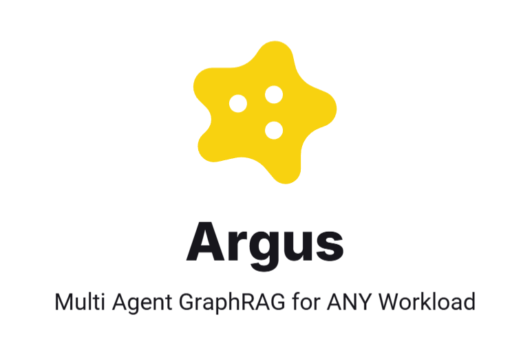
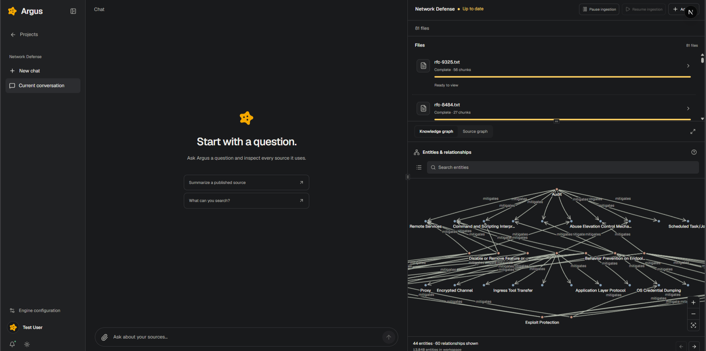
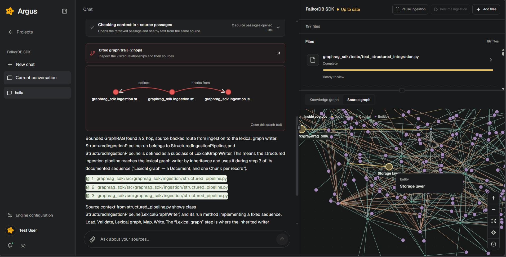
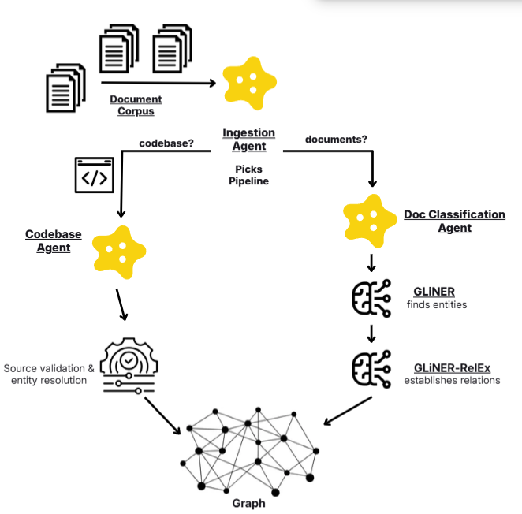
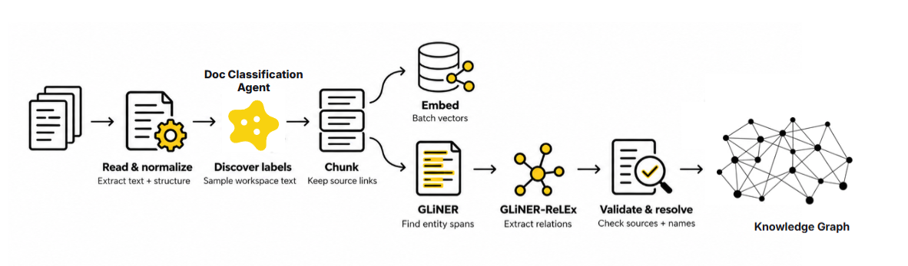
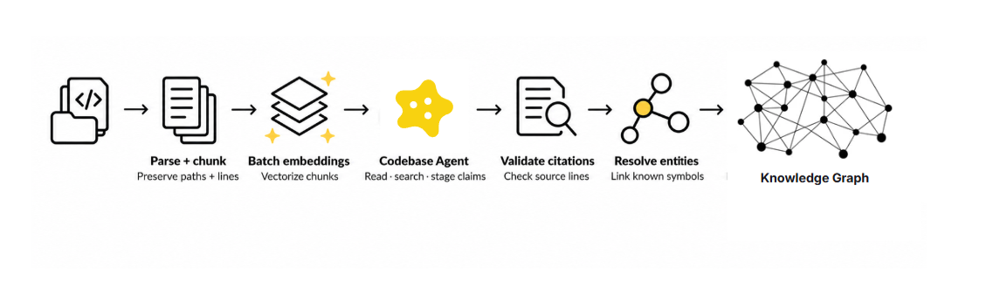
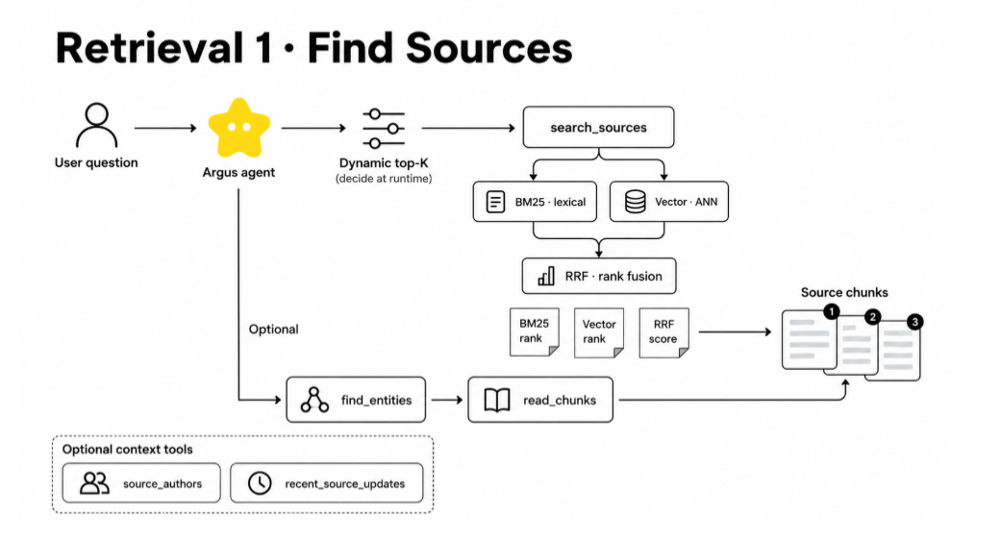
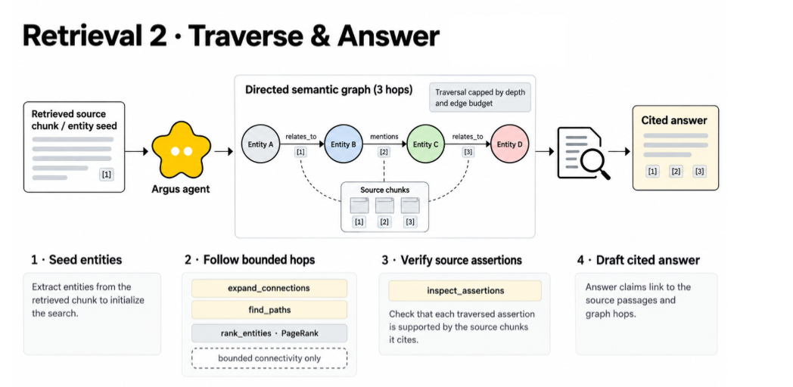

Argus is a **GraphRAG workspace with multiple agents** built on [FalkorDB](https://www.falkordb.com/).

It combines dynamic ingestion, hybrid retrieval, and bounded graph traversal to help answer questions whose context is spread across files and connected concepts.

## GraphRAG on steroids:

Every graph connection points back to a source. The agent can inspect that source and try another path.

## Powerful Ingestion Pipelines for any use case

* Argus picks a reader based on the selected data category. Documents and code use different pipelines
* Document text is split into passages. Search vectors and graph records are built from those passages
* An AI Agent samples the files to learn useful entity and relationship labels before sending for ingestion
* *This helped us save tokens by avoiding sending every chunk to an LLM for entity relationships*
* [GLiNER](https://github.com/urchade/GLiNER) finds names in text. [GLiNER RelEx](https://huggingface.co/knowledgator/gliner-relex-base-v1.0) finds relationships between them
* Argus checks each result against the source text. It groups repeated names before publishing the graph.
* Codebase ingestions uses a separate Agent based on [Flow](https://github.com/samyakkkk/flow)
* Then, a syntax parser also records imports, definitions, and calls.
* Postgres tracks files and jobs. FalkorDB stores the graph and search vectors and everything in between!

## Best of Traditional RAG

* **Hybrid Retrieval with BM25 and RRF reranking** can be toggled on/off
* This helps when a question mixes exact names with different wording.
* A matching passage gives the graph a starting point. Argus follows its entities and searches for connections across sources.
* Search scores rank possible answers. The cited passages support the final answer!

## Multi Agent Architecture

* The chat agent decides when to search, read a passage, check an entity, or follow a graph path.
* Tools listed [here](#retrieval-tools).
* Independent tool calls can run at the same time. Argus combines their results before the next step.
* The agent adds parameters to Falkor searches. It cannot write its own database queries
* A separate agent reads code repositories and builds their graphs

## Backtracking when a path does not hold up

* Each graph relationship points to the passage that supports it.
* `review_path` checks every step in a found path against the current source.
* If a step looks wrong, `path_between` can avoid it and search for another route.
* The trace shows both attempts. A matching quote still needs human or agent interpretation
* We noticed this technique getting popular in the graphRAG community, so decided to put it to the test!

## Hella Transparent

* Every file shows its processing steps, status, and time spent.
* Chat shows searches, graph steps, sources, and timings as the agent works.
* Clicking a citation opens the exact passage behind the answer.
* These traces help locate missing text, weak graph links, and poor search results.

## Duo Graph Viewers

* The source graph shows files, passages, and where entities appear.
* The knowledge graph shows entities and their recorded relationships.
* The same entity can appear in many files. Each occurrence remains linked to its source.
* The viewer loads nearby graph detail as needed. Citations take users back to the source.

Argus supports code, research, security, and structured documents.

## Product

### On a Networking Documentation dump



### Ingesting the FalkorDB GraphRAG SDK codebase!




## Architecture

### Ingestion overview



### Document pipeline



Argus reads documents and splits them into passages. It embeds passages in batches. [GLiNER](https://github.com/urchade/GLiNER) finds names. [GLiNER RelEx](https://huggingface.co/knowledgator/gliner-relex-base-v1.0) finds relationships. Argus checks where each result came from before saving it in FalkorDB. A brief setup pass samples the workspace to choose useful labels. It does not send every passage to a paid language model!

### Codebase pipeline



Code uses a separate agent. It reads files, searches them, and records connections with source citations. A syntax parser adds imports, definitions, inheritance, and named calls.

### Retrieval pipeline





The agent can search passages, inspect graph relationships, and follow paths. It can check a weak step and try another route. Every graph step keeps its source. The final answer cites those sources.

### Retrieval tools

| Tool | Purpose |
| --- | --- |
| `search_sources` | Find passages and explore their graph links. |
| `resolve_entities` | Match names to graph entities. Show ambiguous matches. |
| `read_chunks` | Read a passage and nearby text. |
| `inspect_assertions` | Show a relationship and its source quote. |
| `blast_radius` | Show reachable entities and sources for each step. |
| `path_between` | Find a route between two entities. Avoid rejected steps. |
| `review_path` | Check each step against current source text. |
| `load_bearing` | Rank graph connectivity with PageRank. |
| `source_authors` | Read credited authors from file metadata. |
| `recent_changes` | Show when Argus indexed sources. |

The agent uses these tools instead of writing database queries. Some older tool names remain inside the service. The agent does not see them. It can list its available tools when asked. See [FalkorDB's vector index documentation](https://falkordb.github.io/docs-staging/cypher/indexing/vector-index/) for details on vector search.

## Run locally

### Requirements

* Docker Desktop or Docker Engine with the Compose plugin
* Node.js 22.13 or newer and npm
* Python 3.12
* At least 16 GB RAM is recommended for local extraction. The first run downloads model weights.
* Azure deployments for chat, ingestion setup, and embeddings

### 1. Start the databases

From the repository root:

```powershell
docker compose up -d
```

The development Compose file starts Postgres with `pg_search` and FalkorDB. Data persists in Docker volumes between restarts.

### 2. Install the app and Python environment

```powershell
npm run setup
```

This installs the frontend dependencies, creates `backend/python/.venv` if needed, and installs the pinned Python requirements from `backend/python/requirements-lock.txt`.

### 3. Configure Azure models

Create the ignored local environment file:

```powershell
Copy-Item backend/python/.env.example backend/python/.env
```

Edit `backend/python/.env` and set:

| Variable | Value |
| --- | --- |
| `LLM1_DEPLOYMENT_NAME` | Your stronger Azure model deployment for conversational research and retrieval |
| `LLM1_DEPLOYMENT_URL` | The Azure Responses API URL for the LLM1 deployment |
| `LLM1_DEPLOYMENT_KEY` | The LLM1 API key |
| `LLM2_DEPLOYMENT_NAME` | Your smaller, lower-cost Azure model deployment for ingestion |
| `LLM2_DEPLOYMENT_URL` | The Azure Responses API URL for the LLM2 deployment |
| `LLM2_DEPLOYMENT_KEY` | The LLM2 API key |
| `EMBEDDING_MODEL_NAME` | Your Azure embedding deployment name |
| `EMBEDDING_MODEL_ENDPOINT` | The Azure endpoint for the embedding deployment |
| `EMBEDDING_MODEL_KEY` | Its API key |

Set both language model roles and the embedding deployment. LLM1 powers chat. LLM2 handles document setup and code reading. Embeddings power vector search. These deployments can share an Azure resource or use separate ones. Keep all keys local. The example file includes local database settings.

### 4. Start Argus

```powershell
npm run dev
```

Open the workspace home at [http://localhost:3001](http://localhost:3001). The local service addresses are:

| Service | Address |
| --- | --- |
| Argus web app | [http://localhost:3001](http://localhost:3001) |
| Python API and OpenAPI docs | [http://localhost:4000/docs](http://localhost:4000/docs) |
| FalkorDB Browser | [http://localhost:3005](http://localhost:3005) |
| Postgres | `localhost:5434` (`argus` / `argus_local`) |
| FalkorDB Redis protocol | `localhost:6379` (development default has no password) |

Create a workspace, choose the relevant category or categories, describe the corpus, then upload files through the UI. The first local model use downloads GLiNER weights. Do not place credentials, private corpora, model weights, or database backups in Git.

!!!

---
